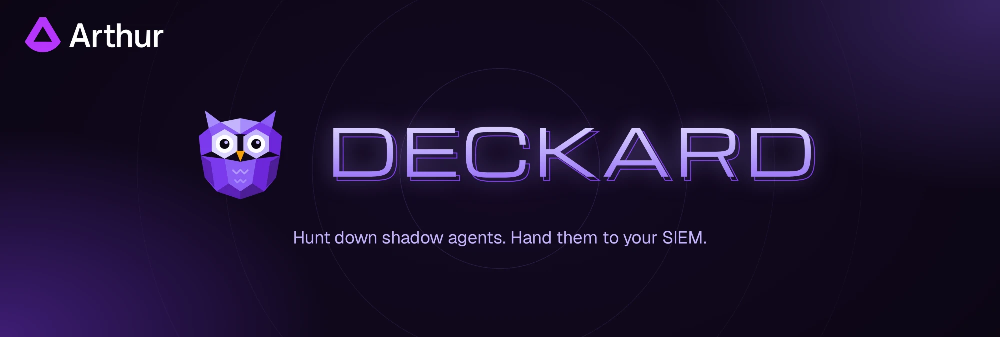

<p align="center">
  
</p>

# Arthur Deckard

[](https://github.com/arthur-ai/arthur-deckard/actions/workflows/ci.yaml)
[](LICENSE)

**Scan your endpoints, cloud, and network for shadow Agents and track them in your SIEM.**

Deckard scans your systems (cloud AI platforms, endpoints, network logs and
your SIEM) for AI agents, and sends every one it finds to Elasticsearch, Splunk, your SIEM or any
webhook. It's headless, read-only, and runs entirely in your environment.

## Quickstart

Find the AI agents on your own machine in a couple of minutes, with no accounts or
credentials. You need Docker and [osquery](https://osquery.io/downloads)
(`brew install --cask osquery` on a Mac).

```bash
git clone https://github.com/arthur-ai/arthur-deckard.git
cd arthur-deckard/docker-compose
./scan-local.sh
docker compose up -d --wait
```

On Windows, you need Docker Desktop and osquery 5.17.0 or later (its `.msi` installer).
From PowerShell:

```powershell
git clone https://github.com/arthur-ai/arthur-deckard.git
cd arthur-deckard\docker-compose
powershell -NoProfile -ExecutionPolicy Bypass -File .\scan-local.ps1
docker compose up -d --wait
```

`scan-local.sh` (`scan-local.ps1` on Windows) lists what's installed on this machine using
the osquery queries from [ai-detection-spec](https://github.com/arthur-ai/ai-detection-spec),
our open format and catalog for finding AI agents on a machine. It changes nothing and
doesn't need root or an administrator.
Deckard matches what it finds against that catalog and sends each agent to an
Elasticsearch running beside it. Open [Kibana](http://localhost:5601/app/discover), log in
as `elastic` with password `changeme`, and Discover lists them. Or ask Elasticsearch from
the terminal:

```bash
curl -s -u elastic:changeme 'localhost:9200/_query?format=txt' \
  -H 'Content-Type: application/json' \
  -d '{"query": "FROM logs-arthur.discovery-* | WHERE event_type == \"arthur.discovery.agent\" | KEEP @timestamp, agent.name, source.name | SORT @timestamp DESC"}'
```

```text
       @timestamp       |   agent.name   |  source.name
------------------------+----------------+---------------
2026-10-26T21:06:33.120Z|Claude Code     |this-machine
2026-10-26T21:06:33.120Z|Claude Desktop  |this-machine
2026-10-26T21:06:33.120Z|Cursor          |this-machine
...
```

Next, add your cloud, MDM or SIEM sources to
[`docker-compose/discovery.yaml`](docker-compose/discovery.yaml) (it has commented
examples), and point its `destination` at your own Elasticsearch, Splunk or webhook. See
[`docker-compose/`](docker-compose/README.md) for more.

## Deploy on Kubernetes

```bash
kubectl create namespace deckard
kubectl -n deckard create secret generic deckard-credentials \
  --from-literal=SPLUNK_HEC_TOKEN="$SPLUNK_HEC_TOKEN"

helm install deckard oci://ghcr.io/arthur-ai/charts/deckard -n deckard --set-file config=discovery.yaml
```

The config references each key in the Secret as `${NAME}`. See the
[chart's README](charts/deckard/README.md) for the details and cloud workload identity.

Each [release](https://github.com/arthur-ai/arthur-deckard/releases) publishes the image
`arthurplatform/deckard` and this chart at the same version; add `--version` to pin one.

## Integrations

| Class | Sources |
|---|---|
| Cloud AI platforms | Vertex AI Agent Engine, AWS Bedrock and AgentCore |
| Endpoints and servers | Jamf Pro, Google Compute Engine, AWS EC2, this machine (`scan-local.sh`, or `scan-local.ps1` on Windows) |
| Network and gateway logs | AWS CloudWatch Logs, Google Cloud Logging |
| Security telemetry | Splunk Enterprise, Elastic Security |

**Destinations:** Elasticsearch and Elastic Security, Splunk HTTP Event Collector, or any
HTTPS webhook.

Missing one you use? [Open an issue](https://github.com/arthur-ai/arthur-deckard/issues).

## Documentation

- [How Deckard works](docs/how-it-works.md): discovery classes, sources and scans
- [Events and alerting](docs/events.md): what your SIEM receives and what to alert on
- [Configuration reference](https://github.com/arthur-ai/arthur-engine/blob/main/ml-engine/docs/standalone-discovery.md):
  every source's fields and permissions, destination options, scheduling

## Contributing

Deckard is the standalone discovery mode of the
[Arthur Engine](https://github.com/arthur-ai/arthur-engine), where its code lives. This
repository holds its deployment and docs. Bug reports and integration requests are welcome
in [issues](https://github.com/arthur-ai/arthur-deckard/issues); report security issues
privately, as described in [SECURITY.md](SECURITY.md). How releases are made:
[RELEASING.md](RELEASING.md).

## License

[MIT](LICENSE)
