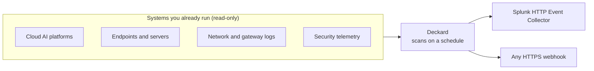

# Arthur Deckard

**Find the rogue AI agents running across your organization, and flag them in the SIEM you already use.**

You can't govern AI agents you don't know about. Most organizations already run more agents
than anyone has accounted for: agents deployed on cloud AI platforms, agents that teams built
and never registered, and agentic tools on employee laptops with shell, filesystem or browser
access. If you're accountable for that AI but have no control over where it shows up, Deckard
gives you the inventory.

Deckard is open source and headless. Point it at the systems you already run and turn it on.
It starts scanning on a schedule, and every agent it finds goes to your SIEM or a webhook,
where your security team already works.

## Why Deckard

- **One view across a fragmented stack.** AI arrives through every team's budget at once, and
  every security tool sees a sliver of it: endpoint tools see laptops, network tools see
  traffic, each cloud console sees what's deployed in it. Deckard stitches those slivers
  into one horizontal view of your AI workloads.
- **Keeps up with a landscape that changes weekly.** New agentic tools, frameworks and model
  providers appear faster than vendor roadmaps move. Deckard is open source, and so are the
  signatures it detects agents by, so coverage moves at the speed of the ecosystem.
- **Delivered where your analysts already work.** Discovered agents land in your SIEM as
  events, beside everything else your SOC investigates, ready for the queries, dashboards and
  alerts you already build there. There's no new console to learn.
- **No procurement cycle.** Deckard is self-hosted and MIT-licensed. You can run it today,
  inside your own environment, without a vendor review, a new SaaS account, or your inventory
  leaving your network.
- **Read-only, by design.** Deckard only lists and searches. It never changes anything it reads,
  each source needs only read permission, and its credentials are kept out of every log, error
  and event.
- **Failures you can see.** Every scan reports whether it succeeded and, if not, why (a rotated
  credential, a missing permission). The same goes for any cloud account or machine it could
  not read, so a blind spot raises an alert of its own instead of going quiet.

## How it works

Deckard finds AI agents by asking the systems that already know about them. Those systems fall
into four classes, and each class sees agents a different way:

| Class | What Deckard reads | What it finds |
|---|---|---|
| **Cloud AI platforms** | The platform's own inventory of deployed agents, and its audit trail | Every agent deployed in a project, account and region, and the identities calling hosted models |
| **Endpoints and servers** | What Arthur's open-source endpoint collector reports through your MDM or cloud tooling | Agentic coding tools, autonomous local agents, AI browsers and extensions, on laptops, VMs and dev boxes |
| **Network and gateway logs** | DNS query logs, flow logs and gateway logs | Internal workloads making requests to GenAI providers or your own LLM gateway, whether or not anyone registered them |
| **Security telemetry** | Your SIEM, through your own SPL or ES\|QL search | Agents that show up in the logs and events you already collect |



You give Deckard one config file, which names three things:

- **Sources:** each one is a system in one of those classes. It has **fields** that say how to
  connect (a URL, a project or account, a credential) and one or more **scan configs** that say
  what each scan does: a query for a SIEM, an agent catalog for an endpoint source, or nothing
  for an inventory. Every source is optional; configure only the ones you use.
- **A schedule:** how often each scan runs. Deckard scans once at startup, then on the
  interval, with no one filing a request.
- **One destination:** Splunk HEC or any HTTPS webhook. Every scan sends one event per agent
  found, plus one event saying how the scan went.

Deckard is one container with no database. Nothing is kept between scans; each scan sends what
the source reports now.

## Quick start: Docker Compose

You need Docker, credentials for at least one source, and a destination: a Splunk HEC token,
or any HTTPS endpoint that accepts a JSON `POST`.

```bash
git clone https://github.com/arthur-ai/arthur-deckard.git
cd arthur-deckard/docker-compose
cp discovery.example.yaml discovery.yaml
cp .env.template .env
mkdir -p secrets
```

1. Edit `discovery.yaml`: name your sources and your destination.
2. Put the secrets it references: `${NAME}` values go in `.env`, and `{file: secrets/...}`
   files go in `secrets/` (a GCP service account key at `secrets/gcp-key.json`, say).
3. Start it and watch the first scan:

   ```bash
   docker compose up
   ```

   Each scan logs `Starting discovery scan of '<source>/<config>'`, then a
   `discovery_scan_outcome` line saying how many agents it sent.

`discovery.yaml`, `.env` and `secrets/` are gitignored.

- Deckard runs as UID `65532`, which must be able to read `discovery.yaml` and everything in
  `secrets/`. On Linux, `chmod` or `chown` them accordingly, and keep them unreadable to
  anyone else.
- A config Deckard cannot use stops it at startup with a message naming the problem:
  `docker compose logs deckard`.
- The image is built for `linux/amd64`. On Apple Silicon, Docker runs it under emulation.
- Set `DECKARD_VERSION` in `.env` to pin an image version instead of tracking `latest`.

## Deploy on Kubernetes: Helm

The same `discovery.yaml` deploys to a cluster:

```bash
helm install deckard ./charts/deckard \
  --namespace deckard --create-namespace \
  --set-file config=discovery.yaml \
  --set secretEnv.SPLUNK_HEC_TOKEN="$SPLUNK_HEC_TOKEN" \
  --set-file 'secretFiles.files.gcp-key\.json=gcp-key.json'

kubectl -n deckard logs -f deployment/deckard
```

Deckard runs as a single non-root pod with a read-only filesystem and needs no Service or
inbound traffic. The [chart's README](charts/deckard/README.md) covers bringing your own
Secrets (External Secrets, Sealed Secrets) and using IRSA or GKE Workload Identity instead
of keys.

## Configuring

```yaml
version: 1

schedule:
  interval: 6h            # how often each source is scanned
  run_on_start: true

sources:                  # one or more
  - name: vertex-prod
    vendor: gcp_vertex
    fields:
      - {key: project_id, value: my-gcp-project}
      - {key: service_account_key, value: {file: secrets/gcp-key.json}}
    configs:
      - {name: agent-engines, query: "", query_language: none, lookback_window_seconds: 21600}

destination:              # exactly one
  type: splunk_hec        # or webhook
  url: https://splunk.example.com:8088/services/collector/event
  token: ${SPLUNK_HEC_TOKEN}

emit_scan_outcomes: true
```

`${NAME}` reads an environment variable and `{file: path}` reads a file beside the config,
so no secret has to live in the file itself. Unknown keys in `schedule`, `destination` and
at the top level are refused, so a typo there fails at startup instead of being ignored.

`lookback_window_seconds` is how far back each scan reads, rounded up to whole hours. Keep it
at least as long as the interval, or whatever happens in the gap is missed. Inventory sources,
like Vertex AI, ignore it.

**[The full configuration reference](https://github.com/arthur-ai/arthur-engine/blob/main/ml-engine/docs/standalone-discovery.md)**
documents every source's fields and the permissions its credential needs, the destination
options (TLS, batching, retries), and exactly how scans are scheduled.

## What your SIEM receives

One event per agent per scan:

```json
{
  "event_type": "arthur.discovery.agent",
  "schema_version": 1,
  "observed_at": "2026-10-07T18:00:00.123456+00:00",
  "source": {"id": "6b0f…", "name": "vertex-prod", "vendor": "gcp_vertex", "config_name": "agent-engines"},
  "agent": {
    "external_id": "projects/123456789012/locations/us-central1/reasoningEngines/111…",
    "name": "personal-assistant",
    "last_seen": "2026-10-07T17:58:12+00:00"
  }
}
```

Each agent records which source found it, where it runs, and when it was last seen, so you
can follow up with the team that owns it. With `emit_scan_outcomes`, each scan also sends one
`arthur.discovery.scan_outcome` event saying whether it succeeded, how many agents it sent,
and why it failed if it did. Every scan sends what the source reports now, so the same agents
arrive each time; dedupe on `agent.external_id` and `source.id`.

Worth alerting on:

- **A new `agent.external_id`**: an agent nobody has seen before.
- **`outcome.succeeded: false`**: a source Deckard can no longer read. `error_code` says why
  (`authentication_failed`, `permission_denied`, …).
- **A non-empty `outcome.denied_scopes`**: a cloud project or account inside the scope that
  the scan was refused, so its agents are invisible.
- **`outcome.device_coverage.unreadable_devices`**: machines the scan could not read, such as
  ones the endpoint collector has never reported from. A machine Deckard cannot see is where
  unmanaged AI sits.

The [reference](https://github.com/arthur-ai/arthur-engine/blob/main/ml-engine/docs/standalone-discovery.md#what-the-destination-receives)
documents every field.

## Integrations

Each source is set with its `vendor` key in the config.

| Class | Integration | `vendor` | What it reads |
|---|---|---|---|
| Cloud AI platforms | Google Cloud Vertex AI Agent Engine | `gcp_vertex` | Every Agent Engine in a project and region |
| | AWS Bedrock and AgentCore | `aws_bedrock` | Bedrock agents and AgentCore runtimes, and the IAM roles CloudTrail shows calling Bedrock models |
| Endpoints and servers | Jamf Pro | `jamf_pro` | The endpoint collector's inventory on each managed Mac |
| | Google Cloud Compute Engine | `gcp_compute_engine` | The same, on VMs across projects, folders or an organization |
| | AWS EC2 | `aws_ec2` | The same, on instances across regions and accounts, through SSM |
| Network and gateway logs | AWS CloudWatch Logs | `aws_network` | Route 53 Resolver query logs, VPC flow logs, or your own format |
| | Google Cloud Logging | `gcp_network` | Cloud DNS query logs and VPC flow logs |
| Security telemetry | Splunk Enterprise | `splunk_enterprise` | Your SPL search |
| | Elastic Security | `elastic_security` | Your ES\|QL query, such as the reference's sample for Kong Gateway logs |

| Destination | `type` |
|---|---|
| Splunk HTTP Event Collector | `splunk_hec` |
| Any HTTPS endpoint (a JSON array per request) | `webhook` |

The endpoint integrations read what Arthur's open-source
[endpoint collector](https://github.com/arthur-ai/arthur-engine/tree/main/integrations/endpoint-ai-discovery)
writes to each machine, which you deploy through the MDM or cloud tooling you already use.

**Coming soon:** Azure AI Foundry, Vercel, CrowdStrike Falcon, Microsoft Defender for Endpoint,
Microsoft Sentinel, LiteLLM proxy and Kong Konnect. Don't see a system you use?
[Open an issue](https://github.com/arthur-ai/arthur-deckard/issues): we prioritize new
integrations by demand.

## How Deckard relates to the Arthur Engine

Deckard is an operating mode of the [Arthur Engine](https://github.com/arthur-ai/arthur-engine):
its ML Engine, running in standalone discovery mode. It runs the `arthurplatform/ml-engine`
image with a discovery config and talks to nothing but your sources and your destination.
This repository holds the deployment and docs; the engine's code lives in `arthur-engine`.

When you want more than an inventory, the [Arthur Platform](https://www.arthur.ai) runs the
same scans and adds what comes next: triage of every agent found, then policies, monitoring
and guardrails for the ones you bring under governance.

## Security

Report vulnerabilities privately; see [SECURITY.md](SECURITY.md).

## License

[MIT](LICENSE)
