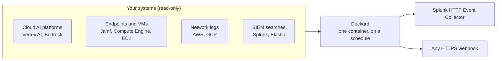

# Arthur Deckard

**Find the rogue AI agents running on your network, and flag them in the SIEM you already use.**

Most organizations already run more AI agents than anyone has written down: agents deployed
on cloud AI platforms, services that call model APIs without being registered anywhere, and
agentic tools on employee laptops with shell, filesystem or browser access. Deckard finds
them. It reads the systems you already run, on a schedule, and sends every agent it finds to
Splunk or any webhook, so the team that watches your security alerts can see your AI too.



- **Runs entirely in your environment.** One container, no database, no Arthur account. It
  talks to your sources and your destination and nothing else.
- **Read-only.** Each source needs only permission to list or search. Deckard never changes
  anything it reads.
- **Keeps credentials out of its output.** No log line, error or event carries a source's
  credentials or the destination's secrets.
- **Tells you when it cannot see.** Every scan reports its outcome, so a source that stops
  working, a cloud account it was refused, or a machine it could not read raises an alert
  of its own instead of going quiet.

## What it finds

| Where agents live | Source (`vendor`) | What Deckard reports |
|---|---|---|
| Cloud AI platforms | Vertex AI Agent Engine (`gcp_vertex`) | Every Agent Engine in a project and region |
| | AWS Bedrock (`aws_bedrock`) | Bedrock agents, AgentCore runtimes, and the IAM roles CloudTrail shows calling Bedrock models |
| Employee Macs | Jamf Pro (`jamf_pro`) | Agentic coding tools, local autonomous agents, AI browsers and extensions |
| Cloud VMs | Compute Engine (`gcp_compute_engine`), EC2 (`aws_ec2`) | The same, on servers and dev boxes, across projects, folders, organizations or accounts |
| Network traffic | AWS network logs (`aws_network`), GCP network logs (`gcp_network`) | Internal workloads calling a model inference API (OpenAI, Anthropic, Bedrock, Azure OpenAI, Gemini, Mistral and others) or your own LLM gateway |
| Security telemetry | Splunk Enterprise (`splunk_enterprise`), Elastic Security (`elastic_security`) | Agents found by your own SPL or ES\|QL search over logs you already collect |

The Jamf, Compute Engine and EC2 sources read an inventory written by Arthur's open-source
[endpoint collector](https://github.com/arthur-ai/arthur-engine/tree/main/integrations/endpoint-ai-discovery),
which you deploy to the machines through the MDM or cloud tooling you already use.

## Quick start: Docker Compose

You need Docker, credentials for at least one source, and a destination: a Splunk HEC token,
or any HTTPS endpoint that accepts a JSON `POST`.

```bash
git clone https://github.com/arthur-ai/arthur-deckard.git
cd arthur-deckard/docker-compose
cp discovery.example.yaml discovery.yaml
cp .env.template .env
mkdir -p secrets
```

1. Edit `discovery.yaml`: name your sources and your destination.
2. Put the secrets it references: `${NAME}` values go in `.env`, and `{file: secrets/...}`
   files go in `secrets/` (a GCP service account key at `secrets/gcp-key.json`, say).
3. Start it and watch the first scan:

   ```bash
   docker compose up
   ```

   Each scan logs `Starting discovery scan of '<source>/<config>'`, then a
   `discovery_scan_outcome` line saying how many agents it sent.

`discovery.yaml`, `.env` and `secrets/` are gitignored.

- Deckard runs as UID `65532`, which must be able to read `discovery.yaml` and everything in
  `secrets/`. On Linux, `chmod` or `chown` them accordingly, and keep them unreadable to
  anyone else.
- A config Deckard cannot use stops it at startup with a message naming the problem:
  `docker compose logs deckard`.
- The image is built for `linux/amd64`. On Apple Silicon, Docker runs it under emulation.
- Set `DECKARD_VERSION` in `.env` to pin an image version instead of tracking `latest`.

## Deploy on Kubernetes: Helm

The same `discovery.yaml` deploys to a cluster:

```bash
helm install deckard ./charts/deckard \
  --namespace deckard --create-namespace \
  --set-file config=discovery.yaml \
  --set secretEnv.SPLUNK_HEC_TOKEN="$SPLUNK_HEC_TOKEN" \
  --set-file 'secretFiles.files.gcp-key\.json=gcp-key.json'

kubectl -n deckard logs -f deployment/deckard
```

Deckard runs as a single non-root pod with a read-only filesystem and needs no Service or
inbound traffic. The [chart's README](charts/deckard/README.md) covers bringing your own
Secrets (External Secrets, Sealed Secrets) and using IRSA or GKE Workload Identity instead
of keys.

## Configuring

The config file has three parts:

```yaml
version: 1

schedule:
  interval: 6h            # how often each source is scanned
  run_on_start: true

sources:                  # one or more
  - name: vertex-prod
    vendor: gcp_vertex
    fields:
      - {key: project_id, value: my-gcp-project}
      - {key: service_account_key, value: {file: secrets/gcp-key.json}}
    configs:
      - {name: agent-engines, query: "", query_language: none, lookback_window_seconds: 21600}

destination:              # exactly one
  type: splunk_hec        # or webhook
  url: https://splunk.example.com:8088/services/collector/event
  token: ${SPLUNK_HEC_TOKEN}

emit_scan_outcomes: true
```

`${NAME}` reads an environment variable and `{file: path}` reads a file beside the config,
so no secret has to live in the file itself. Unknown keys in `schedule`, `destination` and
at the top level are refused, so a typo there fails at startup instead of being ignored.

**[The full configuration reference](https://github.com/arthur-ai/arthur-engine/blob/main/ml-engine/docs/standalone-discovery.md)**
documents every source's fields and the permissions its credential needs, the destination
options (TLS, batching, retries), and exactly how scans are scheduled.

## What your SIEM receives

One event per agent per scan:

```json
{
  "event_type": "arthur.discovery.agent",
  "schema_version": 1,
  "observed_at": "2026-10-07T18:00:00.123456+00:00",
  "source": {"id": "6b0f…", "name": "vertex-prod", "vendor": "gcp_vertex", "config_name": "agent-engines"},
  "agent": {
    "external_id": "projects/123456789012/locations/us-central1/reasoningEngines/111…",
    "name": "personal-assistant",
    "last_seen": "2026-10-07T17:58:12+00:00"
  }
}
```

and, with `emit_scan_outcomes`, one `arthur.discovery.scan_outcome` event per scan saying
whether it succeeded, how many agents it sent, and why it failed if it did. Every scan
sends what the source reports now, so the same agents arrive each time; dedupe on
`agent.external_id` and `source.id`.

Worth alerting on:

- **A new `agent.external_id`**: an agent nobody has seen before.
- **`outcome.succeeded: false`**: a source Deckard can no longer read. `error_code` says why
  (`authentication_failed`, `permission_denied`, …).
- **A non-empty `outcome.denied_scopes`**: a cloud project or account inside the scope that
  the scan was refused, so its agents are invisible.
- **`outcome.device_coverage.unreadable_devices`**: machines the scan could not read, such as
  ones the endpoint collector has never reported from. A machine Deckard cannot see is where
  unmanaged AI sits.

The [reference](https://github.com/arthur-ai/arthur-engine/blob/main/ml-engine/docs/standalone-discovery.md#what-the-destination-receives)
documents every field.

## How Deckard relates to the Arthur Engine

Deckard is the standalone discovery mode of the
[Arthur Engine](https://github.com/arthur-ai/arthur-engine)'s ML Engine, packaged to run on
its own: it runs the `arthurplatform/ml-engine` image with a discovery config. This
repository holds the deployment and docs; the engine's code lives in `arthur-engine`.

When you want more than an inventory, the [Arthur Platform](https://www.arthur.ai) runs the
same scans and makes each discovered agent a governed application, with monitoring,
guardrails and policies.

## Security

Report vulnerabilities privately; see [SECURITY.md](SECURITY.md).

## License

[MIT](LICENSE)
