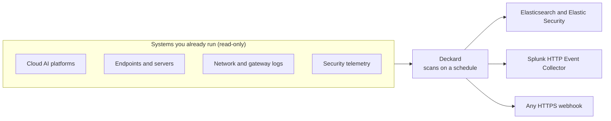

# How Deckard works

You can't govern AI agents you don't know about. Most organizations already run more agents
than anyone has accounted for: agents deployed on cloud AI platforms, agents that teams built
and never registered, and agentic tools on employee laptops with shell, filesystem or browser
access. Deckard finds them and sends them to the SIEM your security team already works in.

## Discovery classes

Deckard finds AI agents by asking the systems that already know about them. Those systems fall
into four classes, and each class sees agents a different way:

| Class | What Deckard reads | What it finds |
|---|---|---|
| **Cloud AI platforms** | The platform's own inventory of deployed agents, and its audit trail | Every agent deployed in a project, account and region, and the identities calling hosted models |
| **Endpoints and servers** | What Arthur's open-source endpoint collector reports through your MDM or cloud tooling | Agentic coding tools, autonomous local agents, AI browsers and extensions, on laptops, VMs and dev boxes |
| **Network and gateway logs** | DNS query logs, flow logs and gateway logs | Internal workloads making requests to GenAI providers or your own LLM gateway, whether or not anyone registered them |
| **Security telemetry** | Your SIEM, through your own SPL or ES\|QL search | Agents that show up in the logs and events you already collect |

No single security tool sees all four. Endpoint tools see laptops, network tools see traffic,
each cloud console sees what's deployed in it. Deckard reads across them, so you get one view
of your AI workloads instead of a sliver of each.

## Integrations

| Class | Integration | `vendor` | What it reads |
|---|---|---|---|
| Cloud AI platforms | Google Cloud Vertex AI Agent Engine | `gcp_vertex` | Every Agent Engine in a project and region |
| | AWS Bedrock and AgentCore | `aws_bedrock` | Bedrock agents and AgentCore runtimes, and the IAM roles CloudTrail shows calling Bedrock models |
| Endpoints and servers | Jamf Pro | `jamf_pro` | The endpoint collector's inventory on each managed Mac |
| | Google Cloud Compute Engine | `gcp_compute_engine` | The same, on VMs across projects, folders or an organization |
| | AWS EC2 | `aws_ec2` | The same, on instances across regions and accounts, through SSM |
| | This machine | `local` | The same, on the machine running Deckard, from a folder `scan-local.sh` writes. Docker Compose only |
| Network and gateway logs | AWS CloudWatch Logs | `aws_network` | Route 53 Resolver query logs, VPC flow logs, or your own format |
| | Google Cloud Logging | `gcp_network` | Cloud DNS query logs and VPC flow logs |
| Security telemetry | Splunk Enterprise | `splunk_enterprise` | Your SPL search |
| | Elastic Security | `elastic_security` | Your ES\|QL query |

The endpoint integrations read what Arthur's open-source
[endpoint collector](https://github.com/arthur-ai/arthur-engine/tree/main/integrations/endpoint-ai-discovery)
writes to each machine, which you deploy through the MDM or cloud tooling you already use. The
signatures it detects agents by are open source too, so coverage keeps up with new tools as
they appear.

## Sources, scans and the destination

You give Deckard one config file, which names three things:

- **Sources:** each one is a system in one of the classes above. It has **fields** that say
  how to connect (a URL, a project or account, a credential) and one or more **scan configs**
  that say what each scan does: a query for a SIEM, an agent catalog for an endpoint source,
  or nothing for an inventory. Every source is optional; configure only the ones you use.
- **A schedule:** how often each scan runs. Deckard scans once at startup, then on the
  interval.
- **One destination:** Elasticsearch, Splunk HEC or any HTTPS webhook. Every scan sends one
  event per agent found, plus one event saying how the scan went. See
  [Events and alerting](events.md).

`${NAME}` in the config reads an environment variable and `{file: path}` reads a file beside
it, so no secret has to live in the config itself.

`lookback_window_seconds` is how far back each scan reads, rounded up to whole hours. Keep it
at least as long as the interval, or whatever happens in the gap is missed. Inventory sources,
like Vertex AI, ignore it.

The [configuration reference](https://github.com/arthur-ai/arthur-engine/blob/main/ml-engine/docs/standalone-discovery.md)
documents every source's fields and the permissions its credential needs, the destination
options, and exactly how scans are scheduled.

## Design principles

- **Read-only.** Deckard only lists and searches. It never changes anything it reads, each
  source needs only read permission, and its credentials are kept out of every log, error and
  event.
- **Runs in your environment.** Deckard is one container with no database, and talks only to
  your sources and your destination. Your inventory never leaves your network.
- **Stateless.** Nothing is kept between scans; each scan sends what the source reports now.
  A restarted Deckard just scans again.
- **Blind spots are reported, not hidden.** A source that fails, a cloud account the scan was
  refused, or a machine it could not read each shows up in the scan's outcome, so a gap in
  coverage raises an alert of its own instead of going quiet.

## Deckard and the Arthur Engine

Deckard is an operating mode of the [Arthur Engine](https://github.com/arthur-ai/arthur-engine):
its ML Engine, running in standalone discovery mode. Each Deckard release is one engine
release under Deckard's name: `arthurplatform/deckard:<version>` is that release's
`arthurplatform/ml-engine` image, unchanged, down to its digest. The GitHub release and the
chart's `arthur.ai/engine-version` annotation say which engine release it is.

When you want more than an inventory, the [Arthur Platform](https://www.arthur.ai) runs the
same scans and adds what comes next: triage of every agent found, then policies, monitoring
and guardrails for the ones you bring under governance.
